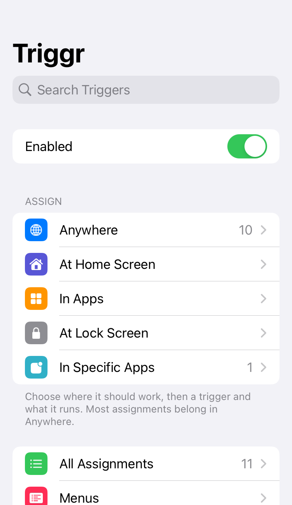
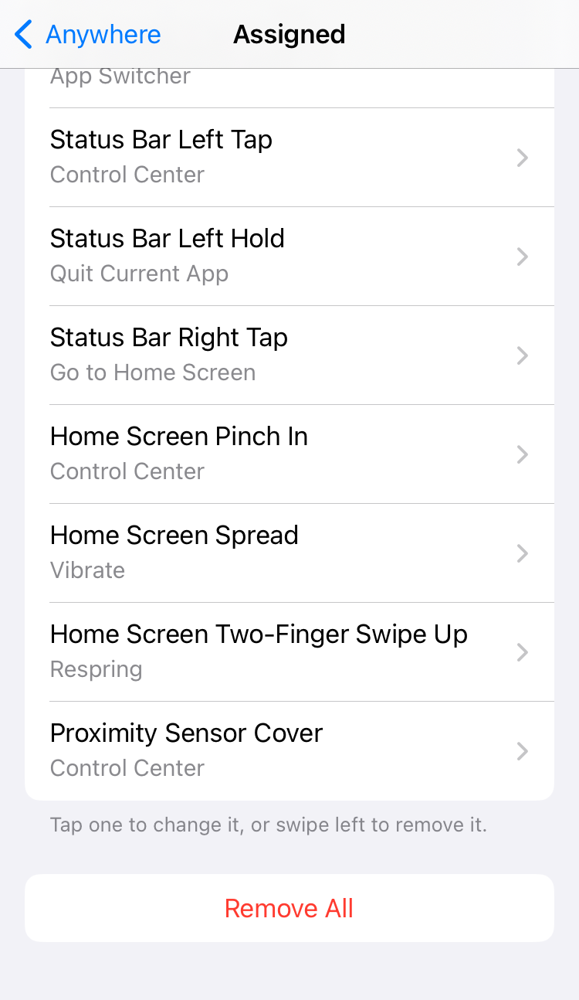
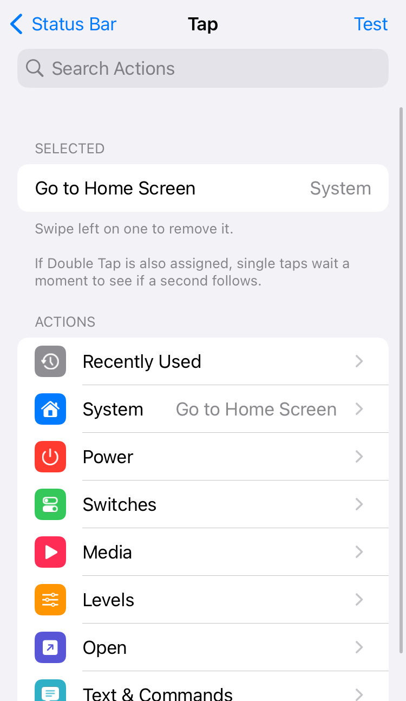
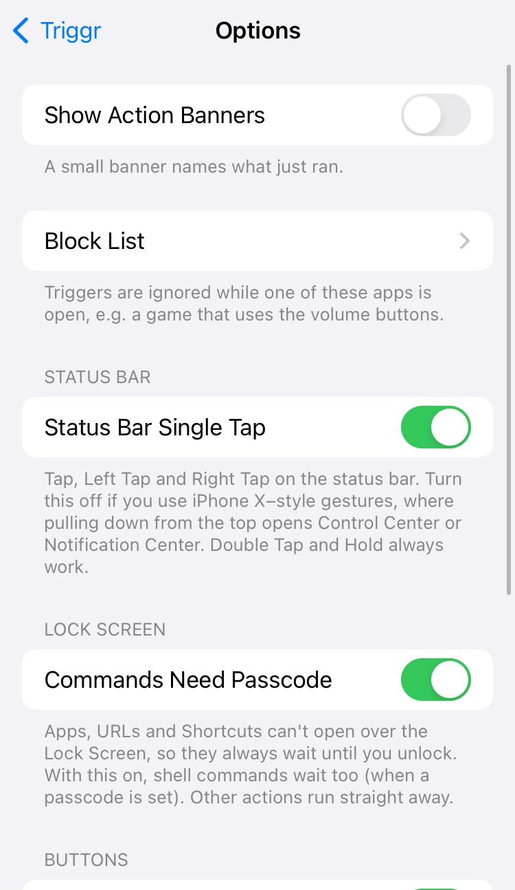

# Triggr 汉化修改版（triggr-cn）

把 Triggr（越狱插件：给按键、开关和手势指派动作）的**界面与配置全量汉化**，并补上若干动作与 2.0 版的条件序列。

- 上游：[`Jond-ie/triggr-beta`](https://github.com/Jond-ie/triggr-beta) 1.5.0，GPL-3.0
- 本仓库：`777qwq/triggr-cn`，分支 `cn274`，当前版本 **1.5.0+cn4.19**
- 适用：iOS 15 – 18，无根（rootless / roothide），arm64 + arm64e

## 装之前

| 项 | 要求 |
|---|---|
| 越狱 | Dopamine / palera1n rootless、roothide 隐根均可 |
| 依赖 | `mobilesubstrate`（ElleKit 亦可） |
| 设备 | 有主屏幕键与 Face ID 机型都支持；触发器按硬件自动过滤 |

装完在「设置 → Triggr」里配置。**改完配置不需要注销**。

## 功能

- **触发器 29 组**：主屏幕键、锁键、音量键与组合键、静音拨片、状态栏点击、通知、Wi-Fi / 蓝牙 / 充电 / 耳机 / 电量 / 时间、应用启动与离开、摇动、贴近感应、应用内两指/三指手势（点按、四向滑动、捏合）。
- **动作 90+ 个**：系统（截图、锁屏、睡眠、回主屏、切换器、Siri、快捷指令、URL、后台 GET、Shell 命令…）、开关（Wi-Fi、蓝牙、飞行、勿扰、低电量、手电、定位、静音…）、媒体、应用、菜单。
- **条件序列**：`如果 / 否则 / 结束条件` + `暂停`，条件支持 Wi-Fi 名、蓝牙设备、充电、锁定、播放中、耳机、低电量、电量阈值、时间段，可加 `@秒`（等 N 秒后仍成立才执行）。

| | |
|---|---|
|  |  |
|  |  |

## 构建

需要 macOS + Xcode 命令行工具（arm64e 切片只有 Apple 的 clang/ld64 能写对，Linux 上产出的 arm64e 会在注入时崩在 `readClass`）、[Theos](https://theos.dev)、`ldid`、`dpkg`。

```sh
git clone --recursive https://github.com/theos/theos.git ~/theos
git clone --depth=1 --filter=blob:none --sparse https://github.com/theos/sdks.git /tmp/sdks
( cd /tmp/sdks && git sparse-checkout set iPhoneOS16.5.sdk )
cp -R /tmp/sdks/iPhoneOS16.5.sdk ~/theos/sdks/

export THEOS=~/theos
make package FINALPACKAGE=1 THEOS_PACKAGE_SCHEME=rootless
```

产物在 `packages/`。CI（`.github/workflows/build.yml`）做同一件事，并额外校验两件容易静默失败的事：**每个 dylib 都有 arm64e 切片**（缺了在 A12+ 上等于没装）和**条件语义用例全部通过**。

roothide 构建：`make package THEOS_PACKAGE_SCHEME=roothide`（需要 [roothide/theos](https://github.com/roothide/theos)），路径会走 `jbroot()`。

## 结构

| 目录 | 产物 | 职责 |
|---|---|---|
| `Tweak/` | `Triggr.dylib`（仅 SpringBoard） | 触发器分发与动作执行 |
| `Relay/` | `TriggrRelay.dylib`（注入所有 App） | 上报状态栏点击 / 摇动 / 多指手势，执行「返回上级」 |
| `Daemon/` | `triggrd`（mobile） | 代跑 Shell 动作（iOS 18 的 SpringBoard 起不了进程），带动作白名单 |
| `Prefs/` | `Triggr.bundle` | 设置界面 |
| `CLI/` `App/` | `triggr` / `TriggrApp` | 只发 Darwin 通知，不直接执行任何东西 |
| `Shared/` | 头文件 | 模式 / 触发器 / 动作目录、条件解析、路径抽象 |
| `scripts/` | `check_conditions.py` | 条件与分支语义的用例（执行器的逐行复刻） |

## 汉化怎么改

界面文案**直接写在源码里**（`Tweak/Tweak.x`、`Prefs/TGSettings.m`），没有运行时映射表。要改文案就改源码，别找别的入口。

`Shared/TGCatalog.h` 是模式 / 触发器 / 动作 id 与中文标题的唯一目录，设置页和 tweak 共用，两边不会说法不一。

## 许可

GPL-3.0（见 `LICENSE`）。上游版权归原作者；本仓库的修改同样以 GPL-3.0 分发。分发二进制时请一并提供对应源码。
